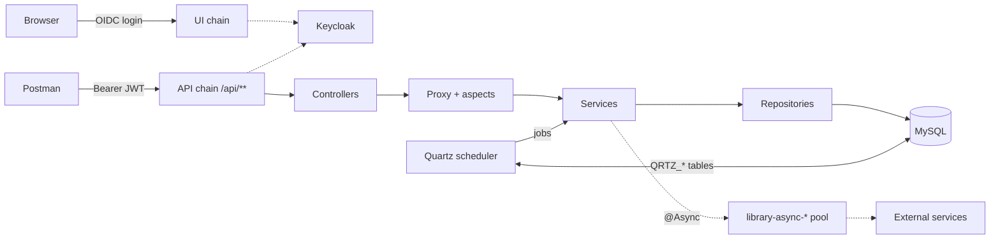

# 📚 Library System


A library management system built as a semester project for the
**Development of High-Load Corporate Systems** course. It provides a REST API and a
simple web UI for managing authors and books, secured with Keycloak.

## Features

- CRUD for authors and books (Spring Data JPA, MapStruct, validation)
- Database schema managed by **Liquibase** migrations
- Web UI for all CRUD operations
- Two authentication flows: **OIDC login** for the UI and **JWT** for API clients
- Role-based access control via `SecurityFilterChain` and `@PreAuthorize`
- Custom annotations: validation constraint, composed annotation, argument resolver
- Aspects: feature toggles, audit trail, input normalization
- Asynchronous processing in a bounded thread pool with timeouts, fallbacks and overload handling
- Scheduled jobs with **Quartz**: the schedule is stored in MySQL and survives restarts
- Unit and integration tests with a JaCoCo coverage gate (min. 60%)
- MySQL and Keycloak start automatically with Docker Compose

## Architecture



## Access Rules

| Operation | USER | ADMIN | Enforced by |
|---|:---:|:---:|---|
| Read (`GET`) | ✅ | ✅ | SecurityFilterChain |
| Delete (`DELETE`) | ❌ | ✅ | SecurityFilterChain |
| Create / Update / Copy (`POST`, `PUT`) | ❌ | ✅ | `@PreAuthorize` |
| Audit log, stock reports | ❌ | ✅ | `@PreAuthorize` |
| No valid token | ❌ 401 | ❌ 401 | OAuth2 Resource Server |

## Custom Annotations

| Annotation | Mechanism | What it does |
|---|---|---|
| `@ValidBookCopies` | Bean Validation constraint (class-level) | A book without ISBN is a unique item, so it can have at most one copy |
| `@PostCreated` | Composed annotation | Combines `@PostMapping` and `@ResponseStatus(HttpStatus.CREATED)` |
| `@CurrentUser` | MVC argument resolver | Injects the authenticated user into controller parameters |

## Aspects (AOP)

| Annotation | Advice | Concern | Observable effect |
|---|---|---|---|
| `@FeatureToggle("book-deletion")` | `@Around` | Disable an operation via configuration | `503`, the method is not executed |
| `@Audited(action = "BOOK_CREATED")` | `@AfterReturning` | Audit trail of successful operations | Entry in `GET /api/audit` |
| `@NormalizeInput` | `@Before` | Trim and collapse whitespace | `"  Kobzar  "` is stored as `"Kobzar"` |

**Self-invocation demo.** `BookService.copy(id)` calls `this.create(...)`, bypassing the proxy,
so the aspects on `create` are silently skipped — see `SelfInvocationTest`.

## ⚡ Asynchronous Processing

| Operation | Style | Where |
|---|---|---|
| Email notification about a new book | Fire-and-forget (`@Async void`) | `BookService.create` |
| Rating from an external reviews service | `@Async` → `CompletableFuture` | `GET /api/books/{id}/details` |
| Price from a partner bookstore | `@Async` → `CompletableFuture` | `GET /api/books/{id}/details` |

Bounded `ThreadPoolTaskExecutor` (core 2, max 4, queue 10, prefix `library-async-`).
Parallel calls are combined with `thenCombine`; failures and 2 s timeouts fall back to
`available: false`; a full pool returns `503` with `Retry-After` for book details and skips
notifications with a `WARN` log.

## Scheduled Jobs (Quartz)

The schedule is stored in MySQL (JDBC job store). The `QRTZ_*` tables are created by a
Liquibase changeset; Spring Boot does not create them (`initialize-schema: never`).

| Job | Trigger | Schedule (Europe/Kyiv) | Parameters | Misfire |
|---|---|---|---|---|
| `catalog-normalization` | `catalog-normalization-nightly` | daily at 03:00 | `batchSize=100` | do nothing |
| `stock-report` | `stock-report-daily` | daily at 08:00 | defaults: `daily`, threshold `1`, `maxTitles=20` | fire once now |
| `stock-report` | `stock-report-weekly` | Mondays at 09:00 | overrides: `weekly`, threshold `3` | do nothing |

- **Catalog normalization** cleans titles and names stored without normalization
  (e.g. copies created via self-invocation) — the same rules as `@NormalizeInput`.
- **Stock report** lists books with few copies left; one report per name and date
  (`GET /api/reports/stock`, admin only).

**Reliability**

| Concern | Solution |
|---|---|
| Jobs are thin | Each job reads its `JobDataMap` and makes one call to a `@Transactional` service |
| Idempotency | Normalization only touches dirty records; reports are upserted by name and date (unique key) |
| Concurrent runs | `@DisallowConcurrentExecution` on both jobs |
| Failures | Logged at ERROR, no immediate refire, the trigger stays scheduled — the next run retries |
| Wrong parameters | Missing or malformed keys fail with an explicit message; unknown trigger keys are ignored |
| Time zone | All cron triggers use `Europe/Kyiv` explicitly |
| Redeployments | `overwrite-existing-jobs: false` + `QuartzScheduleSynchronizer`: triggers are rescheduled only when their definition changed, so stored state and misfires survive restarts |

```yaml
library:
  scheduling:
    time-zone-id: Europe/Kyiv
    catalog-normalization-cron: "0 0 3 * * ?"
    daily-stock-report-cron: "0 0 8 * * ?"
    weekly-stock-report-cron: "0 0 9 ? * MON"
```

## Getting Started

**Requirements:** JDK 21, Docker Desktop.

Run `LibrarySystemApplication` from IntelliJ IDEA (or `./mvnw spring-boot:run`).
MySQL and Keycloak start automatically; the Keycloak realm is imported from
`keycloak/course-realm.json`.

| Service | URL |
|---|---|
| Web UI | http://localhost:8081 |
| REST API | http://localhost:8081/api |
| Keycloak admin | http://localhost:8080 (`admin` / `admin`) |

| User | Password | Roles |
|---|---|---|
| `alice` | `alice123` | USER, ADMIN |
| `bob` | `bob123` | USER |

## API

| Resource | Endpoints |
|---|---|
| Authors | `GET` `POST` `/api/authors`, `GET` `PUT` `DELETE` `/api/authors/{id}` |
| Books | `GET` `POST` `/api/books`, `GET` `PUT` `DELETE` `/api/books/{id}`, `POST` `/api/books/{id}/copy` |
| Book details | `GET` `/api/books/{id}/details` — book + external rating + bookstore offer |
| Current user | `GET` `/api/me` |
| Audit log | `GET` `/api/audit` (ADMIN only) |
| Stock reports | `GET` `/api/reports/stock` (ADMIN only) |

All endpoints require `Authorization: Bearer <token>`.

## Testing

Tests are built with **JUnit 5**, **Mockito**, **AssertJ** and **Awaitility**. Unit tests run
without a database or Spring context; async behavior is verified in minimal Spring contexts;
idempotency of scheduled jobs is verified by integration tests on an in-memory **H2** database
with the real Liquibase schema; Quartz behavior is verified on a real in-memory scheduler.

```bash
./mvnw clean verify
```

The JaCoCo report is generated at `target/site/jacoco/index.html`.
The build fails if line or instruction coverage drops below **60%**.

| Area | Test classes |
|---|---|
| Services | `AuthorServiceTest`, `BookServiceTest`, `BookDetailsServiceTest` |
| Security | `KeycloakJwtAuthenticationConverterTest` |
| Custom annotations | `ValidBookCopiesTest`, `PostCreatedTest`, `CreateEndpointsTest`, `CurrentUserArgumentResolverTest`, `CurrentUserControllerTest`, `WebConfigTest` |
| Aspects | `FeatureToggleAspectTest`, `FeaturePropertiesTest`, `FeatureToggleProxyTest`, `AuditAspectTest`, `AuditTrailTest`, `AuditProxyTest`, `AuditControllerTest`, `NormalizeInputAspectTest`, `DtoNormalizationTest`, `NormalizeInputProxyTest`, `SelfInvocationTest` |
| Async | `AsyncConfigTest`, `AsyncExecutorThreadTest`, `LoggingAsyncExceptionHandlerTest`, `BookNotificationServiceTest`, `FireAndForgetTest`, `FakeEmailSenderTest`, `ParallelCallsTest`, `FakeGatewaysTest`, `BookDetailsControllerTest`, `ExecutorRejectionTest`, `OverloadHandlingTest` |
| Scheduling | `QuartzSchemaConfigurationTest`, `QuartzJobsConfigTest`, `QuartzScheduleSynchronizerTest`, `QuartzExecutionBehaviourTest`, `JobParametersTest`, `CatalogNormalizationJobTest`, `StockReportJobTest`, `CatalogNormalizationServiceTest`, `CatalogNormalizationServiceIntegrationTest`, `StockReportServiceTest`, `StockReportServiceIntegrationTest`, `StockReportControllerTest` |

## Postman

Import `postman/Library-API.postman_collection.json`, run the **Auth** folder to get
tokens, then run any request or the whole collection via **Run collection**.

## Project Structure

```
src/main/java/com/example/library_system/
├── aop/            # aspects and their annotations
├── audit/          # audit log storage
├── config/         # security, web, async and clock configuration
├── controller/     # REST controllers and overload handler
├── dto/            # request/response objects
├── entity/         # JPA entities
├── external/       # async clients for external services
├── mapper/         # MapStruct mappers
├── notification/   # asynchronous email notifications
├── repository/     # Spring Data JPA repositories
├── scheduling/     # Quartz jobs, triggers and schedule synchronization
├── service/        # business logic
├── validation/     # custom Bean Validation constraint
└── web/            # composed annotation and argument resolver
```

## Roadmap

- [x] CRUD, Liquibase, OIDC + JWT security
- [x] Unit tests with 60%+ coverage
- [x] Custom annotations: constraint, composed annotation, argument resolver
- [x] AOP: feature toggles, audit trail, input normalization
- [x] Async processing: bounded executor, parallel calls, timeouts, overload handling
- [x] Scheduled jobs with Quartz: persistent schedule, idempotent jobs, misfire handling
- [ ] Book loans and return reminders
- [ ] Multi-module Maven structure

## 👤 Author

**Kateryna Doroftei**