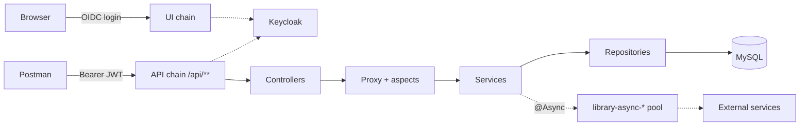

# 📚 Library System


A library management system built as a semester project for the
**Development of High-Load Corporate Systems** course. It provides a REST API and a
simple web UI for managing authors and books, secured with Keycloak.

## Features

- CRUD for authors and books (Spring Data JPA, MapStruct, validation)
- Database schema managed by **Liquibase** migrations
- Web UI for all CRUD operations
- Two authentication flows: **OIDC login** for the UI and **JWT** for API clients
- Role-based access control via `SecurityFilterChain` and `@PreAuthorize`
- Custom annotations: validation constraint, composed annotation, argument resolver
- Aspects: feature toggles, audit trail, input normalization
- Asynchronous processing in a bounded thread pool with timeouts, fallbacks and overload handling
- Unit tests with a JaCoCo coverage gate (min. 60%)
- MySQL and Keycloak start automatically with Docker Compose

## Architecture



## Access Rules

| Operation | USER | ADMIN | Enforced by |
|---|:---:|:---:|---|
| Read (`GET`) | ✅ | ✅ | SecurityFilterChain |
| Delete (`DELETE`) | ❌ | ✅ | SecurityFilterChain |
| Create / Update / Copy (`POST`, `PUT`) | ❌ | ✅ | `@PreAuthorize` |
| Audit log (`GET /api/audit`) | ❌ | ✅ | `@PreAuthorize` |
| No valid token | ❌ 401 | ❌ 401 | OAuth2 Resource Server |

## Custom Annotations

| Annotation | Mechanism | What it does |
|---|---|---|
| `@ValidBookCopies` | Bean Validation constraint (class-level) | A book without ISBN is a unique item, so it can have at most one copy |
| `@PostCreated` | Composed annotation | Combines `@PostMapping` and `@ResponseStatus(HttpStatus.CREATED)` |
| `@CurrentUser` | MVC argument resolver | Injects the authenticated user (username and roles) into controller parameters |

## Aspects (AOP)

| Annotation | Advice | Concern | Observable effect |
|---|---|---|---|
| `@FeatureToggle("book-deletion")` | `@Around` | Disable an operation via configuration | `503`, the method is not executed |
| `@Audited(action = "BOOK_CREATED")` | `@AfterReturning` | Audit trail of successful operations | Entry in `GET /api/audit` |
| `@NormalizeInput` | `@Before` | Trim and collapse whitespace, blank optional fields → `null` | `"  Kobzar  "` is stored as `"Kobzar"` |

**Self-invocation demo.** `BookService.copy(id)` calls `this.create(...)`, bypassing the Spring
proxy, so the aspects on `create` are silently skipped. This is intentional — see `SelfInvocationTest`.

## ⚡ Asynchronous Processing

Slow side effects (~1 s each) run in a dedicated, bounded thread pool instead of blocking the request.

| Operation | Style | Where |
|---|---|---|
| Email notification about a new book | Fire-and-forget (`@Async void`) | `BookService.create` |
| Rating from an external reviews service | `@Async` → `CompletableFuture<BookRating>` | `GET /api/books/{id}/details` |
| Price and availability from a partner bookstore | `@Async` → `CompletableFuture<StoreOffer>` | `GET /api/books/{id}/details` |

**Executor.** `ThreadPoolTaskExecutor` with core size 2, max size 4, queue capacity 10 and thread
prefix `library-async-`, set as the default `@Async` executor.

**Parallel calls.** Rating and offer are requested concurrently and combined with `thenCombine`,
so the details endpoint answers in ~1 s instead of ~2 s.

**Failure handling.**

| Situation | Behavior |
|---|---|
| External service fails | Fallback value (`available: false`), response is still `200` |
| External service hangs | Waiting stops after a 2 s timeout (`orTimeout`), fallback value is used |
| Error in a `void` async method | Recorded by `AsyncUncaughtExceptionHandler` (ERROR log) |
| Pool is full — book details | `503 Service Unavailable` with `Retry-After: 5`, never a random `500` |
| Pool is full — notification | Notification is skipped with a `WARN` log, the book is still created |

```yaml
library:
  async:
    core-pool-size: 2
    max-pool-size: 4
    queue-capacity: 10
    thread-name-prefix: library-async-
  external:
    timeout: 2s
```

## Getting Started

**Requirements:** JDK 21, Docker Desktop.

Run `LibrarySystemApplication` from IntelliJ IDEA (or `./mvnw spring-boot:run`).
MySQL and Keycloak start automatically; the Keycloak realm is imported from
`keycloak/course-realm.json`.

| Service | URL |
|---|---|
| Web UI | http://localhost:8081 |
| REST API | http://localhost:8081/api |
| Keycloak admin | http://localhost:8080 (`admin` / `admin`) |

| User | Password | Roles |
|---|---|---|
| `alice` | `alice123` | USER, ADMIN |
| `bob` | `bob123` | USER |

## API

| Resource | Endpoints |
|---|---|
| Authors | `GET` `POST` `/api/authors`, `GET` `PUT` `DELETE` `/api/authors/{id}` |
| Books | `GET` `POST` `/api/books`, `GET` `PUT` `DELETE` `/api/books/{id}`, `POST` `/api/books/{id}/copy` |
| Book details | `GET` `/api/books/{id}/details` — book + external rating + bookstore offer |
| Current user | `GET` `/api/me` — username, roles and whether the user can manage the catalog |
| Audit log | `GET` `/api/audit` — latest audit entries (ADMIN only) |

All endpoints require `Authorization: Bearer <token>`.

## Testing

Unit tests are built with **JUnit 5**, **Mockito**, **AssertJ** and **Awaitility**. Most tests
run without a database, network or Spring context; async behavior is verified in minimal Spring
contexts that contain only the async configuration and the tested beans.

```bash
./mvnw clean verify
```

The JaCoCo report is generated at `target/site/jacoco/index.html`.
The build fails if line or instruction coverage drops below **60%**.

| Area | Test classes |
|---|---|
| Services | `AuthorServiceTest`, `BookServiceTest`, `BookDetailsServiceTest` |
| Security | `KeycloakJwtAuthenticationConverterTest` |
| Custom annotations | `ValidBookCopiesTest`, `PostCreatedTest`, `CreateEndpointsTest`, `CurrentUserArgumentResolverTest`, `CurrentUserControllerTest`, `WebConfigTest` |
| Aspects | `FeatureToggleAspectTest`, `FeaturePropertiesTest`, `FeatureToggleProxyTest`, `AuditAspectTest`, `AuditTrailTest`, `AuditProxyTest`, `AuditControllerTest`, `NormalizeInputAspectTest`, `DtoNormalizationTest`, `NormalizeInputProxyTest`, `SelfInvocationTest` |
| Async | `AsyncConfigTest`, `AsyncExecutorThreadTest`, `LoggingAsyncExceptionHandlerTest`, `BookNotificationServiceTest`, `FireAndForgetTest`, `FakeEmailSenderTest`, `ParallelCallsTest`, `FakeGatewaysTest`, `BookDetailsControllerTest`, `ExecutorRejectionTest`, `OverloadHandlingTest` |

## Postman

Import `postman/Library-API.postman_collection.json`, run the **Auth** folder to get
tokens, then run any request or the whole collection via **Run collection**.
Every request includes an automated status check.

## 📂 Project Structure

```
src/main/java/com/example/library_system/
├── aop/            # aspects and their annotations
├── audit/          # audit log storage
├── config/         # security, web, async and clock configuration
├── controller/     # REST controllers and overload handler
├── dto/            # request/response objects
├── entity/         # JPA entities
├── external/       # async clients for external services
├── mapper/         # MapStruct mappers
├── notification/   # asynchronous email notifications
├── repository/     # Spring Data JPA repositories
├── service/        # business logic
├── validation/     # custom Bean Validation constraint
└── web/            # composed annotation and argument resolver
```

## Roadmap

- [x] CRUD, Liquibase, OIDC + JWT security
- [x] Unit tests with 60%+ coverage
- [x] Custom annotations: constraint, composed annotation, argument resolver
- [x] AOP: feature toggles, audit trail, input normalization
- [x] Async processing: bounded executor, parallel calls, timeouts, overload handling
- [ ] Book loans and return deadlines
- [ ] Multi-module Maven structure

## 👤 Author

**Kateryna Doroftei**