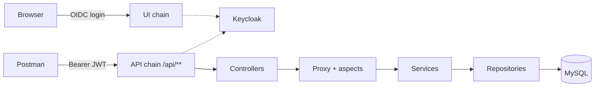

# 📚 Library System

A library management system built as a semester project for the
**Development of High-Load Corporate Systems** course. It provides a REST API and a
simple web UI for managing authors and books, secured with Keycloak.

## ✨ Features

- CRUD for authors and books (Spring Data JPA, MapStruct, validation)
- Database schema managed by **Liquibase** migrations
- Web UI for all CRUD operations
- Two authentication flows: **OIDC login** for the UI and **JWT** for API clients
- Role-based access control via `SecurityFilterChain` and `@PreAuthorize`
- Custom annotations: validation constraint, composed annotation, argument resolver
- Aspects: feature toggles, audit trail, input normalization
- Unit tests with a JaCoCo coverage gate (min. 60%)
- MySQL and Keycloak start automatically with Docker Compose

## Architecture

## Access Rules

| Operation | USER | ADMIN | Enforced by |
|---|:---:|:---:|---|
| Read (`GET`) | ✅ | ✅ | SecurityFilterChain |
| Delete (`DELETE`) | ❌ | ✅ | SecurityFilterChain |
| Create / Update / Copy (`POST`, `PUT`) | ❌ | ✅ |