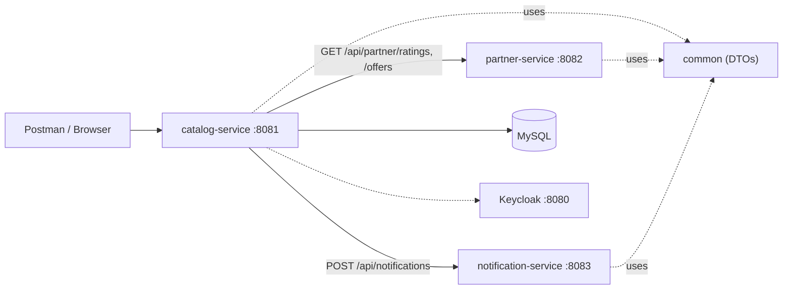
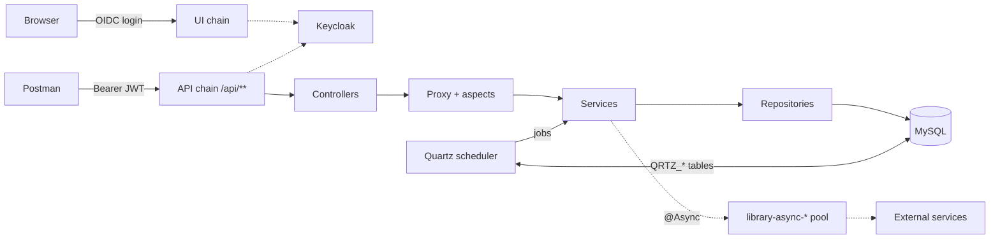

# 📚 Library System


A library management system built as a semester project for the
**Development of High-Load Corporate Systems** course. It provides a REST API and a
simple web UI for managing authors and books, secured with Keycloak.

## Features

- CRUD for authors and books (Spring Data JPA, MapStruct, validation)
- Database schema managed by **Liquibase** migrations
- Web UI for all CRUD operations
- Two authentication flows: **OIDC login** for the UI and **JWT** for API clients
- Role-based access control via `SecurityFilterChain` and `@PreAuthorize`
- Custom annotations: validation constraint, composed annotation, argument resolver
- Aspects: feature toggles, audit trail, input normalization
- Asynchronous processing in a bounded thread pool with timeouts, fallbacks and overload handling
- Scheduled jobs with **Quartz**: the schedule is stored in MySQL and survives restarts
- Unit and integration tests with a JaCoCo coverage gate (min. 60%)
- MySQL and Keycloak start automatically with Docker Compose
- **Multi-module Maven** build: three independent services and a shared `common` module
- Services talk to each other over **HTTP** (`RestClient`); each one has its own `Dockerfile`

## Services

The repository is a multi-module Maven build. One `./mvnw clean verify` in the root builds and
tests every module. Each service is a standalone Spring Boot application with its own `main`
class, `application.yml`, port, tests and `Dockerfile`.

| Module | Port | Responsibility | Depends on |
|---|---|---|---|
| `catalog-service` | 8081 | Books, authors, security, UI, aspects, async, Quartz | `common` |
| `partner-service` | 8082 | Book ratings (reviews service) and bookstore offers | `common` |
| `notification-service` | 8083 | Accepts and sends email notifications | `common` |
| `common` | — | Shared DTOs only: `BookRating`, `StoreOffer`, `NotificationRequest` | — |



**Root POM** (`library-system-parent`, `packaging pom`):

| Section | Contents | Effect |
|---|---|---|
| `<modules>` | `common`, `catalog-service`, `partner-service`, `notification-service` | One build for the whole repository |
| `<dependencies>` | `spring-boot-starter-test`, Lombok | Inherited by every module, not declared in modules |
| `<dependencyManagement>` | versions of `common` and MapStruct | Modules declare these dependencies without versions |
| `<pluginManagement>` | `spring-boot-maven-plugin` configuration | Enabled only in the POM of each service, not in `common` |
| `<build><plugins>` | compiler (Lombok processor), JaCoCo with a 60% gate | Applied to every module |

**Service independence.** No service depends on another service in Maven; they only share
`common`. `./mvnw dependency:tree` confirms this (see `docs/lab7/dependency-tree.txt`):

```
com.example:catalog-service:jar:0.0.1-SNAPSHOT
+- com.example:common:jar:0.0.1-SNAPSHOT:compile
com.example:partner-service:jar:0.0.1-SNAPSHOT
+- com.example:common:jar:0.0.1-SNAPSHOT:compile
com.example:notification-service:jar:0.0.1-SNAPSHOT
+- com.example:common:jar:0.0.1-SNAPSHOT:compile
```

The catalog only knows the other services' URLs (`library.external.partner-url`,
`library.notifications.url`). The async timeouts and fallbacks protect it from real network
failures: if `partner-service` is down, book details still return `200` with
`available: false`; if `notification-service` is down, the book is still created and the
failure is logged.

## Catalog Architecture



## Access Rules

| Operation | USER | ADMIN | Enforced by |
|---|:---:|:---:|---|
| Read (`GET`) | ✅ | ✅ | SecurityFilterChain |
| Delete (`DELETE`) | ❌ | ✅ | SecurityFilterChain |
| Create / Update / Copy (`POST`, `PUT`) | ❌ | ✅ | `@PreAuthorize` |
| Audit log, stock reports | ❌ | ✅ | `@PreAuthorize` |
| No valid token | ❌ 401 | ❌ 401 | OAuth2 Resource Server |

## Custom Annotations

| Annotation | Mechanism | What it does |
|---|---|---|
| `@ValidBookCopies` | Bean Validation constraint (class-level) | A book without ISBN is a unique item, so it can have at most one copy |
| `@PostCreated` | Composed annotation | Combines `@PostMapping` and `@ResponseStatus(HttpStatus.CREATED)` |
| `@CurrentUser` | MVC argument resolver | Injects the authenticated user into controller parameters |

## Aspects (AOP)

| Annotation | Advice | Concern | Observable effect |
|---|---|---|---|
| `@FeatureToggle("book-deletion")` | `@Around` | Disable an operation via configuration | `503`, the method is not executed |
| `@Audited(action = "BOOK_CREATED")` | `@AfterReturning` | Audit trail of successful operations | Entry in `GET /api/audit` |
| `@NormalizeInput` | `@Before` | Trim and collapse whitespace | `"  Kobzar  "` is stored as `"Kobzar"` |

**Self-invocation demo.** `BookService.copy(id)` calls `this.create(...)`, bypassing the proxy,
so the aspects on `create` are silently skipped — see `SelfInvocationTest`.

## ⚡ Asynchronous Processing

| Operation | Style | Where |
|---|---|---|
| Email notification about a new book | Fire-and-forget (`@Async void`) | `BookService.create` |
| Rating from an external reviews service | `@Async` → `CompletableFuture` | `GET /api/books/{id}/details` |
| Price from a partner bookstore | `@Async` → `CompletableFuture` | `GET /api/books/{id}/details` |

Bounded `ThreadPoolTaskExecutor` (core 2, max 4, queue 10, prefix `library-async-`).
Parallel calls are combined with `thenCombine`; failures and 2 s timeouts fall back to
`available: false`; a full pool returns `503` with `Retry-After` for book details and skips
notifications with a `WARN` log.

## Scheduled Jobs (Quartz)

The schedule is stored in MySQL (JDBC job store). The `QRTZ_*` tables are created by a
Liquibase changeset; Spring Boot does not create them (`initialize-schema: never`).

| Job | Trigger | Schedule (Europe/Kyiv) | Parameters | Misfire |
|---|---|---|---|---|
| `catalog-normalization` | `catalog-normalization-nightly` | daily at 03:00 | `batchSize=100` | do nothing |
| `stock-report` | `stock-report-daily` | daily at 08:00 | defaults: `daily`, threshold `1`, `maxTitles=20` | fire once now |
| `stock-report` | `stock-report-weekly` | Mondays at 09:00 | overrides: `weekly`, threshold `3` | do nothing |

- **Catalog normalization** cleans titles and names stored without normalization
  (e.g. copies created via self-invocation) — the same rules as `@NormalizeInput`.
- **Stock report** lists books with few copies left; one report per name and date
  (`GET /api/reports/stock`, admin only).

**Reliability**

| Concern | Solution |
|---|---|
| Jobs are thin | Each job reads its `JobDataMap` and makes one call to a `@Transactional` service |
| Idempotency | Normalization only touches dirty records; reports are upserted by name and date (unique key) |
| Concurrent runs | `@DisallowConcurrentExecution` on both jobs |
| Failures | Logged at ERROR, no immediate refire, the trigger stays scheduled — the next run retries |
| Wrong parameters | Missing or malformed keys fail with an explicit message; unknown trigger keys are ignored |
| Time zone | All cron triggers use `Europe/Kyiv` explicitly |
| Redeployments | `overwrite-existing-jobs: false` + `QuartzScheduleSynchronizer`: triggers are rescheduled only when their definition changed, so stored state and misfires survive restarts |

```yaml
library:
  scheduling:
    time-zone-id: Europe/Kyiv
    catalog-normalization-cron: "0 0 3 * * ?"
    daily-stock-report-cron: "0 0 8 * * ?"
    weekly-stock-report-cron: "0 0 9 ? * MON"
```

## Getting Started

**Requirements:** JDK 21, Docker Desktop.

**Option 1: everything from IntelliJ IDEA.** Run `PartnerServiceApplication`,
`NotificationServiceApplication` and `LibrarySystemApplication` (working directory
`$MODULE_WORKING_DIR$`). MySQL and Keycloak start automatically with the catalog; the Keycloak
realm is imported from `keycloak/course-realm.json`.

**Option 2: partner and notification services in Docker.**

```bash
./mvnw clean package -DskipTests
docker compose --profile services up -d --build
```

Then run only `LibrarySystemApplication` from IntelliJ IDEA. Stop the containers with
`docker compose --profile services stop`. The catalog image can be built with
`docker build -t library/catalog-service:0.0.1-SNAPSHOT catalog-service`.

| Service | URL |
|---|---|
| Web UI | http://localhost:8081 |
| REST API | http://localhost:8081/api |
| Partner service | http://localhost:8082/api/partner |
| Notification service | http://localhost:8083/api/notifications |
| Keycloak admin | http://localhost:8080 (`admin` / `admin`) |

| User | Password | Roles |
|---|---|---|
| `alice` | `alice123` | USER, ADMIN |
| `bob` | `bob123` | USER |

## API

| Resource | Endpoints |
|---|---|
| Authors | `GET` `POST` `/api/authors`, `GET` `PUT` `DELETE` `/api/authors/{id}` |
| Books | `GET` `POST` `/api/books`, `GET` `PUT` `DELETE` `/api/books/{id}`, `POST` `/api/books/{id}/copy` |
| Book details | `GET` `/api/books/{id}/details` — book + external rating + bookstore offer |
| Current user | `GET` `/api/me` |
| Audit log | `GET` `/api/audit` (ADMIN only) |
| Stock reports | `GET` `/api/reports/stock` (ADMIN only) |

All catalog endpoints require `Authorization: Bearer <token>`.

Internal service APIs (no authentication, called by the catalog):

| Service | Endpoints |
|---|---|
| `partner-service` | `GET` `/api/partner/ratings?title=`, `GET` `/api/partner/offers?title=` (`503` when a partner is unavailable) |
| `notification-service` | `POST` `/api/notifications` (`202`, `400` without recipient or subject), `GET` `/api/notifications` (sent letters) |

## Testing

Tests are built with **JUnit 5**, **Mockito**, **AssertJ** and **Awaitility**. Unit tests run
without a database or Spring context; async behavior is verified in minimal Spring contexts;
idempotency of scheduled jobs is verified by integration tests on an in-memory **H2** database
with the real Liquibase schema; Quartz behavior is verified on a real in-memory scheduler.

```bash
./mvnw clean verify
```

JaCoCo reports are generated per module at `<module>/target/site/jacoco/index.html`.
The build fails if line or instruction coverage of any module drops below **60%**.

| Module | Tests | Line coverage |
|---|---:|---:|
| `common` | 3 | 100% |
| `partner-service` | 6 | 91% |
| `notification-service` | 5 | 100% |
| `catalog-service` | 141 | 90% |

| Area | Test classes |
|---|---|
| Services | `AuthorServiceTest`, `BookServiceTest`, `BookDetailsServiceTest` |
| Security | `KeycloakJwtAuthenticationConverterTest` |
| Custom annotations | `ValidBookCopiesTest`, `PostCreatedTest`, `CreateEndpointsTest`, `CurrentUserArgumentResolverTest`, `CurrentUserControllerTest`, `WebConfigTest` |
| Aspects | `FeatureToggleAspectTest`, `FeaturePropertiesTest`, `FeatureToggleProxyTest`, `AuditAspectTest`, `AuditTrailTest`, `AuditProxyTest`, `AuditControllerTest`, `NormalizeInputAspectTest`, `DtoNormalizationTest`, `NormalizeInputProxyTest`, `SelfInvocationTest` |
| Async | `AsyncConfigTest`, `AsyncExecutorThreadTest`, `LoggingAsyncExceptionHandlerTest`, `BookNotificationServiceTest`, `FireAndForgetTest`, `ParallelCallsTest`, `BookDetailsControllerTest`, `ExecutorRejectionTest`, `OverloadHandlingTest` |
| HTTP clients | `PartnerServiceGatewayTest`, `HttpNotificationSenderTest` |
| Partner service | `ReviewsServiceTest`, `BookstoreServiceTest`, `PartnerControllerTest` |
| Notification service | `EmailServiceTest`, `NotificationControllerTest` |
| Common | `CommonDtoTest` |
| Scheduling | `QuartzSchemaConfigurationTest`, `QuartzJobsConfigTest`, `QuartzScheduleSynchronizerTest`, `QuartzExecutionBehaviourTest`, `JobParametersTest`, `CatalogNormalizationJobTest`, `StockReportJobTest`, `CatalogNormalizationServiceTest`, `CatalogNormalizationServiceIntegrationTest`, `StockReportServiceTest`, `StockReportServiceIntegrationTest`, `StockReportControllerTest` |

## Postman

Import `postman/Library API.postman_collection.json`, run the **Auth** folder to get
tokens, then run any request or the whole collection via **Run collection**.
The **Services** folder calls `partner-service` and `notification-service` directly.

## Project Structure

```
library-repo/
├── pom.xml                 # root POM: modules, shared dependencies and plugins
├── compose.yaml            # MySQL, Keycloak, partner and notification services
├── common/                 # shared DTOs (records only, no Spring)
├── catalog-service/        # main application, port 8081
│   ├── Dockerfile
│   └── src/main/java/com/example/library_system/
│       ├── aop/            # aspects and their annotations
│       ├── audit/          # audit log storage
│       ├── config/         # security, web, async, clock and HTTP clients
│       ├── controller/     # REST controllers and overload handler
│       ├── dto/            # request/response objects
│       ├── entity/         # JPA entities
│       ├── external/       # async client and HTTP gateway to partner-service
│       ├── mapper/         # MapStruct mappers
│       ├── notification/   # async notifications sent to notification-service
│       ├── repository/     # Spring Data JPA repositories
│       ├── scheduling/     # Quartz jobs, triggers and schedule synchronization
│       ├── service/        # business logic
│       ├── validation/     # custom Bean Validation constraint
│       └── web/            # composed annotation and argument resolver
├── partner-service/        # ratings and bookstore offers, port 8082
│   └── Dockerfile
└── notification-service/   # email notifications, port 8083
    └── Dockerfile
```

## Roadmap

- [x] CRUD, Liquibase, OIDC + JWT security
- [x] Unit tests with 60%+ coverage
- [x] Custom annotations: constraint, composed annotation, argument resolver
- [x] AOP: feature toggles, audit trail, input normalization
- [x] Async processing: bounded executor, parallel calls, timeouts, overload handling
- [x] Scheduled jobs with Quartz: persistent schedule, idempotent jobs, misfire handling
- [x] Multi-module Maven structure: separate services, shared `common`, Dockerfiles
- [ ] Book loans and return reminders

## 👤 Author

**Kateryna Doroftei**